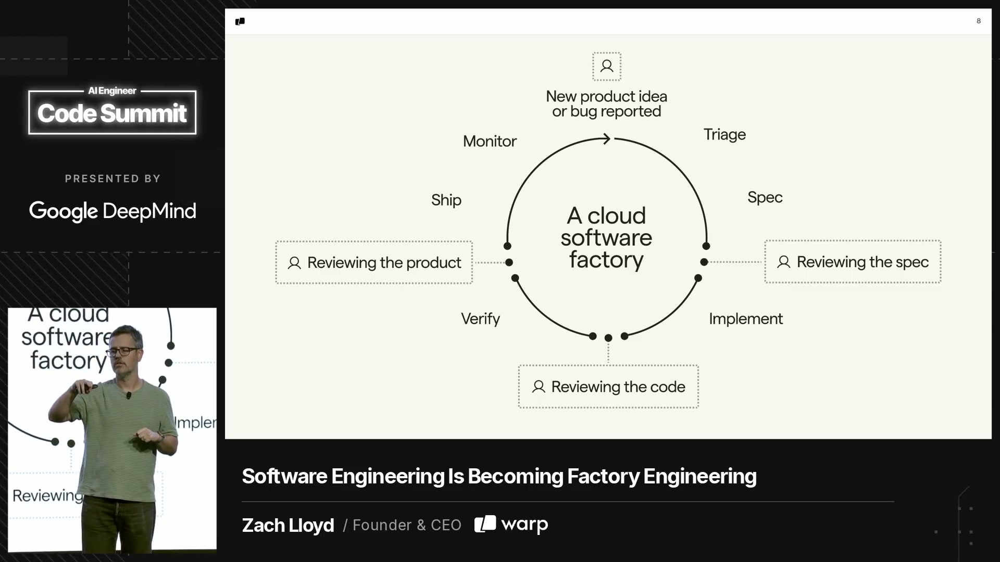

# Video notes

Turn a video talk into Markdown study notes, with timestamp links and the slide, chart, or code screenshot beside the explanation that uses it.

[](LICENSE) 

A transcript can tell you that the speaker pointed to a chart. Video notes lets Claude Code or Codex inspect the chart itself. The `vnotes` CLI fetches the words and images. The agent chooses the moments worth keeping and writes a Markdown file you can read alongside the original video.

**See the finished notes.** In Zach Lloyd’s Warp talk, the notes walk through a delivery loop, identify its three human review points, and explain how to read a cost-versus-correctness plot. Each section links back to the talk. [Read the illustrated example](examples/warp-software-factory/README.md).

[](examples/warp-software-factory/README.md)

## Setup

Install Python 3, `yt-dlp`, and FFmpeg (including `ffprobe`). For the agent workflow, sign in to Claude Code or Codex. The Python helper uses the standard library.

```sh
git clone https://github.com/oojBuffalo/video-notes.git
cd video-notes
mkdir -p ~/.local/bin
ln -s "$PWD/vnotes" ~/.local/bin/vnotes
export PATH="$HOME/.local/bin:$PATH"
vnotes --help
```

To use the skill interactively, run the pair of commands for your agent from the repository root, then start a new agent session.

```sh
# Claude Code
mkdir -p ~/.claude/skills
ln -s "$PWD/skill" ~/.claude/skills/video-notes

# Codex
mkdir -p ~/.codex/skills
ln -s "$PWD/skill" ~/.codex/skills/video-notes
```

For videos without usable captions, install `whisper-cli` from whisper.cpp and set `VNOTES_WHISPER_MODEL` to a local `ggml-*.bin` model. The helper also looks in `/usr/local/share/whisper/models`. It retries transcription on the CPU if the GPU attempt fails.

## Quickstart

Ask your agent, “Make study notes from this video and focus on how the speaker measures cost and correctness.” Include the URL. To run the same skill from a terminal using your Codex login, run the following command.

```sh
vnotes notes 'https://www.youtube.com/watch?v=0LeT996Hz3E' \
  --agent codex --prompt 'Explain the cost and correctness plots.' \
  --out notes/warp
```

Open the Markdown path printed when the run finishes. The transcript, timeline index, and frames stay beside it, so you can move the whole folder and keep the image links working. Omit `--agent` to use Claude Code.

## How it works

1. **Fetch the words and the timeline.** The helper prefers human captions in the video’s language, then automatic captions. It builds an index sheet for each five minutes of video, sampling a frame every ten seconds.
2. **Choose the moments.** The agent reads the transcript and examines every sheet. The index can reveal a diagram the speaker never names.
3. **Check the pictures.** The helper pulls full-size frames at the selected times. If a slide is mid-transition, the skill asks for nearby frames. The agent opens individual images before quoting small text.
4. **Write the notes.** Each section links to its starting time. The headless CLI checks local image links before saving the agent’s Markdown.

Index tiles can miss short-lived slides. The project’s acceptance runs used YouTube talks. Measurements, harness permissions, and known limits are in the [validation report](docs/validation.md).

## Commands

| Command | What it does |
| --- | --- |
| `vnotes fetch URL DIR` | Writes `meta.json`, `transcript.txt`, and timeline sheets. Add `--transcribe` to use the audio even when captions exist. |
| `vnotes frames DIR TIME...` | Extracts frames from a fetched video. Times can be seconds, `mm:ss`, or `h:mm:ss`. |
| `vnotes notes URL` | Runs the skill headless. Accepts `--agent claude` or `--agent codex`, `--prompt TEXT`, and `--out DIR`. |
| `vnotes direct URL --via PROVIDER` | Uses three model calls to plan, write, and check the notes. Accepts `--model`, `--prompt`, and `--out`. |

### Direct mode

Use `direct` to run the fixed sequence without an agent CLI. The model receives the transcript and images. It can request up to 40 frames during planning. The helper saves `plan.md` and `draft.md` alongside the finished notes. If the checked draft still links to missing images, the text is saved in `notes.rejected.md`.

| `--via` | Authentication and model selection |
| --- | --- |
| `chatgpt` | Uses the login saved by Codex in `~/.codex/auth.json` and consumes ChatGPT plan quota. |
| `openai` | Reads `OPENAI_API_KEY`. |
| `anthropic` | Reads `ANTHROPIC_API_KEY`. |
| `openrouter` | Reads `OPENROUTER_API_KEY`. |
| `endpoint` | Set `VNOTES_BASE_URL` to an OpenAI-compatible API base, pass `--model`, and set `VNOTES_API_KEY` if your endpoint requires a key. |

## Contributing

The CLI lives in `vnotes`. The agent follows the [video-notes skill](skill/SKILL.md). Use Python 3.11 or later to run the offline tests from the repository root.

```sh
python3 -m unittest discover -s tests -v
```

Keep personal video bundles in `notes/` and development runs in `runs/`. Git ignores both. The published example contains the finished Markdown and the frames it links to.

## License

The project code is available under the [MIT License](LICENSE). The example frames come from Zach Lloyd’s presentation and retain their original rights. [Watch the source talk](https://www.youtube.com/watch?v=0LeT996Hz3E).
