# Engineer Your Coding Agents Like Any Other System — Zach Lloyd, Warp

**Zach Lloyd**, founder and CEO of Warp · AI Engineer Code Summit · **18:30** · [Watch on YouTube](https://www.youtube.com/watch?v=0LeT996Hz3E)

Lloyd calls a system that uses evidence from past coding-agent runs to improve future runs a **software factory**. The team defines the workflow in code, records what agents actually do, and scores their work against specific criteria. A recurring failure can then become a pull request against the factory itself. Warp also replays its own engineering tasks to decide which models, tools, and agent arrangements are worth their cost.

## From Google Docs to local coding agents · [00:24](https://www.youtube.com/watch?v=0LeT996Hz3E&t=24s)

Lloyd led engineering for Google Docs as it grew to hundreds of millions of users. He says Warp’s open-source agentic terminal has about 65,000 GitHub stars and nearly a million developer users. Warp also builds the platform for internal software factories that he demonstrates here.

In the teams he talks to, engineers commonly run one or more coding agents on their own machines. Most of the audience recognized that workflow in a show of hands. When Lloyd asked who was already building or using an internal factory, many hands went up there too. [01:09](https://www.youtube.com/watch?v=0LeT996Hz3E&t=69s)

## Why interactive prompting stops scaling · [01:45](https://www.youtube.com/watch?v=0LeT996Hz3E&t=105s)

- **Throughput.** Even with several agents working at once, progress depends on how many sessions a person can prompt. An issue or automated signal should be able to start work on its own.
- **Quality and cost.** When each engineer chooses their own models, skills, and setup, a platform team has little evidence about which combination produces good work at a reasonable cost.
- **Security and governance.** Independently configured local agents leave each developer responsible for controls that the organization needs to manage across the team.

## What makes a software factory · [03:06](https://www.youtube.com/watch?v=0LeT996Hz3E&t=186s)

Lloyd treats automations, AI teammates, shared skills and MCP connections, and personal agent swarms as building blocks. His slide defines the system that connects them as “A code-defined, closed-loop system for continuously measuring and improving cloud coding agents.”

**Define it in code.** Specify which agents can run, what triggers them, how an issue moves between stages, which tools and repositories are available, and where the agents execute. Lloyd compares this to Terraform. A team can branch the definition, test a different configuration, and roll back a change. The example on screen puts agents, runners, scorers, and benchmarks alongside `factory.yaml`. Its `agentDefaults` include `model: auto` and `runner: standard`. [03:57](https://www.youtube.com/watch?v=0LeT996Hz3E&t=237s)

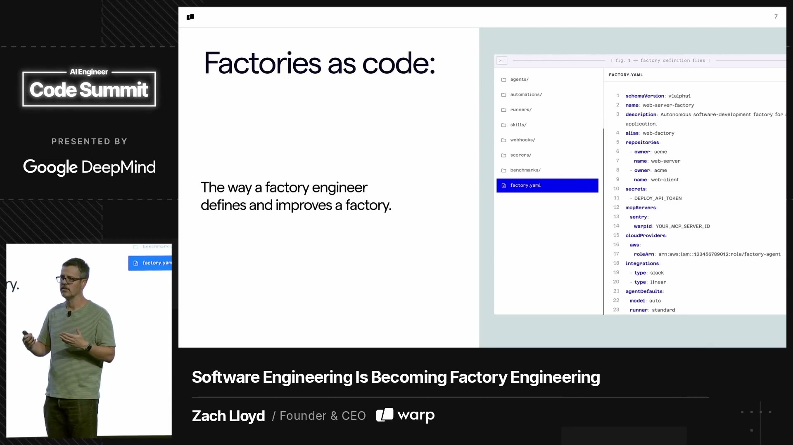

**Close the loop.** A person’s idea, a bug report, or an automated signal can start work. Read the diagram clockwise through **Triage → Spec → Implement → Verify → Ship → Monitor**. The diagram places human review at three handoffs. Someone reviews the spec before implementation, the code before verification, and the product before shipping. Each trip around the loop generates evidence the team can use to improve the next one. [04:37](https://www.youtube.com/watch?v=0LeT996Hz3E&t=277s)

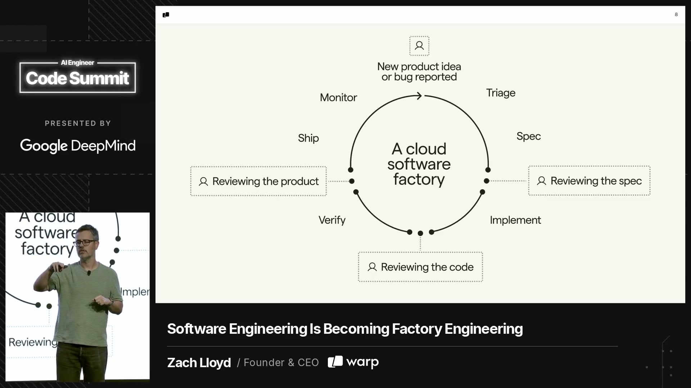

**Measure the trade-off.** Lloyd wants to know what quality a configuration achieves, what that quality costs, and how much work gets through. His slide plots `Correctness` vertically against `Average cost` horizontally. The highlighted `gpt-5.6-sol (high)` point is labeled **95%** and **$6.13**. A point farther left costs less, and a point higher up scores better on this task set. [05:17](https://www.youtube.com/watch?v=0LeT996Hz3E&t=317s)

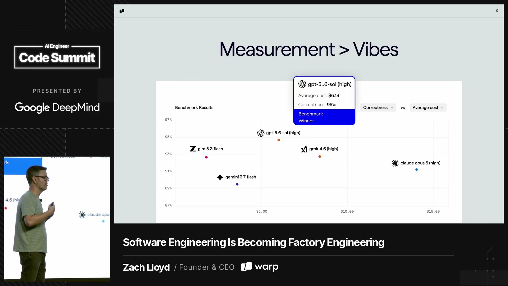

## What the engineer is responsible for · [06:37](https://www.youtube.com/watch?v=0LeT996Hz3E&t=397s)

Debuggers, profilers, and Chrome DevTools helped Lloyd learn how hand-written software behaved. The analogous tools on his factory-engineering slide are **Blueprints, Automations, Evals, Self-improvement, Benchmarks, and A/B tests**. They answer different questions. A blueprint defines where work can go. An eval judges a run. A benchmark lets the team rerun comparable work under a different configuration.

Lloyd gives engineers two responsibilities. Product engineering still asks whether the shipped change solves a real customer problem. Factory engineering asks what the team can change about the system that produced it. A change to a shared workflow can affect every subsequent task.

## The infrastructure stack · [08:07](https://www.youtube.com/watch?v=0LeT996Hz3E&t=487s)

Lloyd presents one possible stack. Read his diagram from the bottom up. The slide gives **IMPROVEMENT** its own layer between inference and orchestration, and marks the bottom four layers as eligible for Warp or customer hosting.

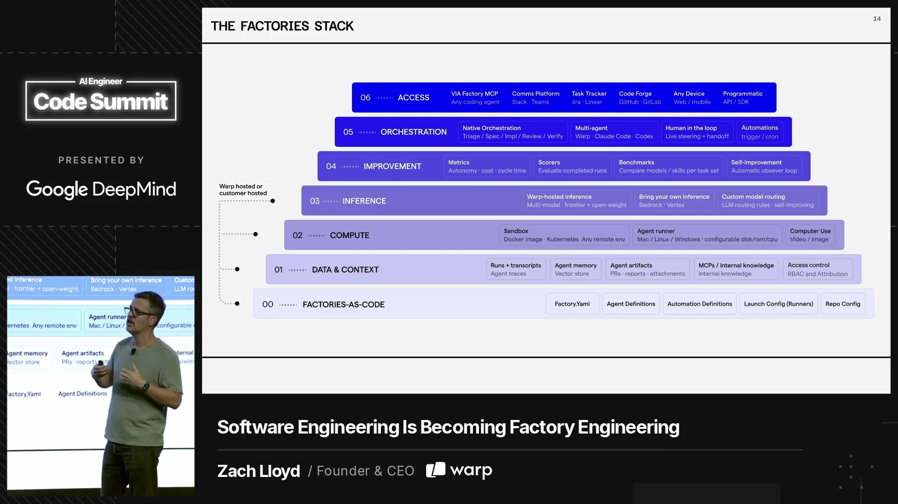

| Layer on the slide | What it makes possible |
| --- | --- |
| 00 · FACTORIES-AS-CODE | Version the factory, agent and automation definitions, runner launch settings, and repo configuration. An agent can propose changes to these same files. |
| 01 · DATA & CONTEXT | Preserve conversations, traces, PRs, reports, screenshots, and videos. A later evaluator can inspect the work that produced an outcome. The slide also includes agent memory, internal knowledge, access control, and attribution. |
| 02 · COMPUTE | Sandboxes give runs a repeatable environment and improve isolation. The diagram includes Mac, Linux, and Windows runners with configurable resources. |
| 03 · INFERENCE | Vary the model and the harness that runs it. Lloyd names Claude Code, Codex, and Warp and also allows for a team’s own harness with organizational context built in. The slide includes hosted inference, bring-your-own inference, and custom model routing. |
| 04 · IMPROVEMENT | Track autonomy, cost, and cycle time. Score completed runs, benchmark alternatives on a task set, and use recurring failures to propose changes. |
| 05 · ORCHESTRATION | Move work between stages and agents. The diagram includes live human steering and handoff, as well as event- and schedule-driven automation. |
| 06 · ACCESS | Let people and other agents use the factory where work already happens. Lloyd calls for API and MCP access alongside tools such as Slack, Linear, Jira, and GitHub. |

## Demo · A workflow you can review in Git · [10:54](https://www.youtube.com/watch?v=0LeT996Hz3E&t=654s)

Lloyd opens Warp’s `eng-factory-slim/factory.yaml`. The file declares `schemaVersion: v1alpha2`, a credential strategy, a network policy with allowed hosts, and named repositories. The file tree shows directories for agents, automations, runners, scorers, skills, stages, benchmarks, and self-improvement.

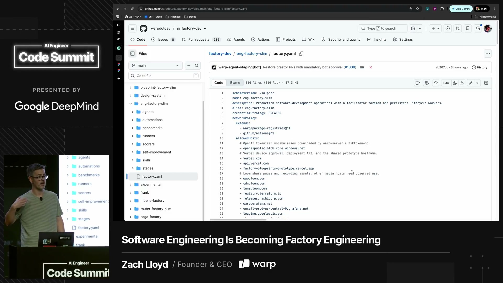

The blueprint specifies what one stage hands to the next. In the research stage shown on screen, the prompt comes from `stages/research.md`. An `answered` outcome delivers cited findings and closes the task. A `needs_worker` outcome sends it to `work`. A worker can then enter design exploration, specification, implementation, or review according to what the requester asked for.

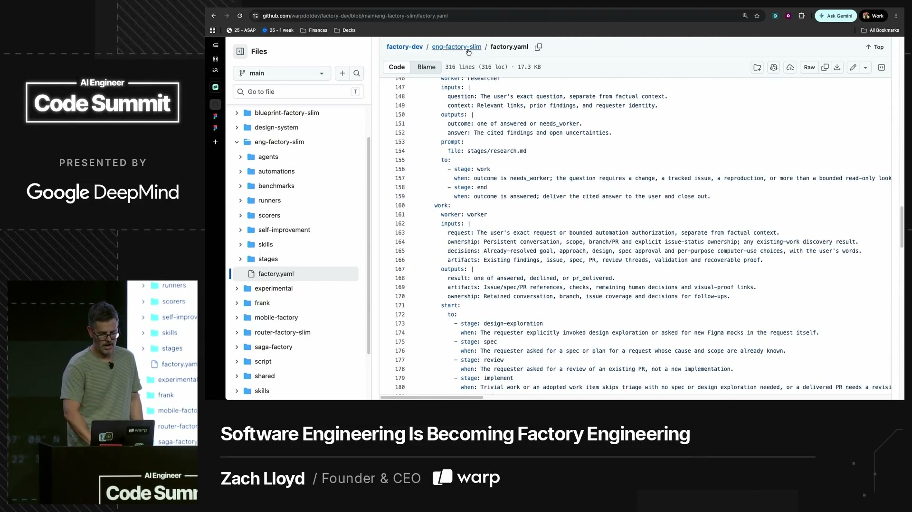

## Demo · From team activity to a single run · [11:34](https://www.youtube.com/watch?v=0LeT996Hz3E&t=694s)

The team-wide run list works like a shared live document. Lloyd picks Maggie’s **Implement Opus 5.5 High Plan** task. The row identifies Slack as its source and shows that image and video artifacts are available.

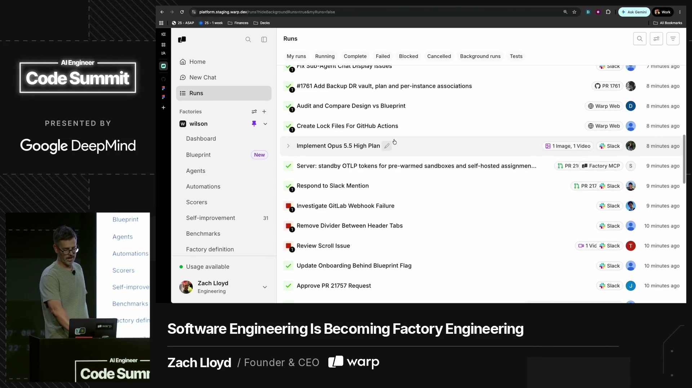

Opening the run puts its conversation and stage history alongside its artifacts. On screen, the agent records two human approvals, 12 passed checks, nine skipped checks, and an unstable merge status. It leaves the PR open. The artifact pane links three open PRs and lists 127 screen captures. This is the evidence a later reviewer or scorer can revisit after the live session ends.

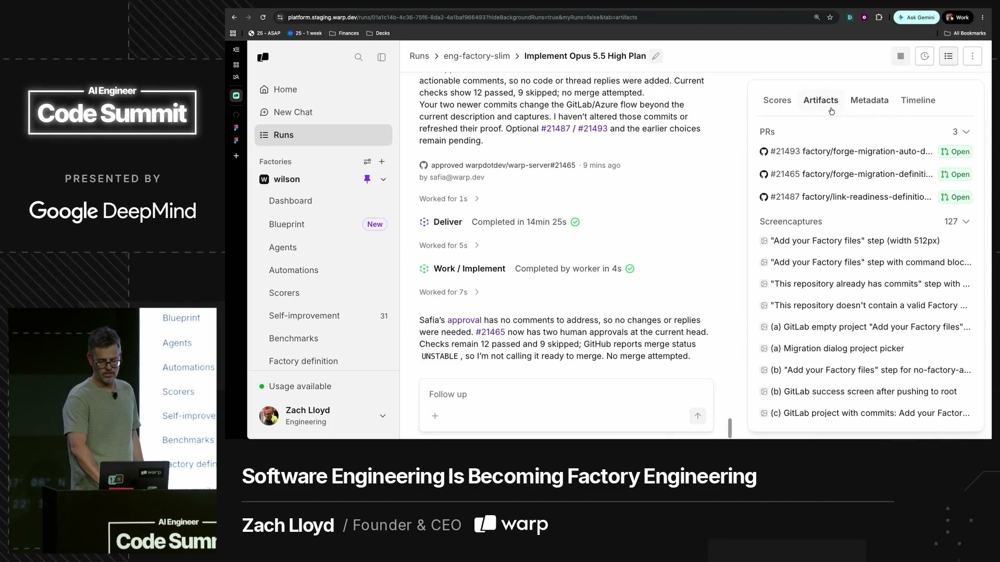

## Demo · Throughput, cycle time, and cost · [12:30](https://www.youtube.com/watch?v=0LeT996Hz3E&t=750s)

Central recording lets the platform team compare work across agents without installing measurement tools on every laptop. Lloyd pairs delivery metrics such as cycle time with a measure of human effort. The **Last 7 days** productivity screen shows the following figures.

| Question | On-screen result |
| --- | --- |
| How much human input did a PR take? | 19.4 human interactions per PR |
| How much work went through the factory? | 342 pull requests, 188 merged, and 1,188 runs including 693 top-level runs |
| Where did time elapse? | Median kickoff → PR **20m**, PR → first human review **2.4h**, first human review → merge **24m**, and kickoff → merge **5.8h** |

The wait for first human review exceeded the time from kickoff to opening a PR in this snapshot. The dashboard exposes that handoff directly.

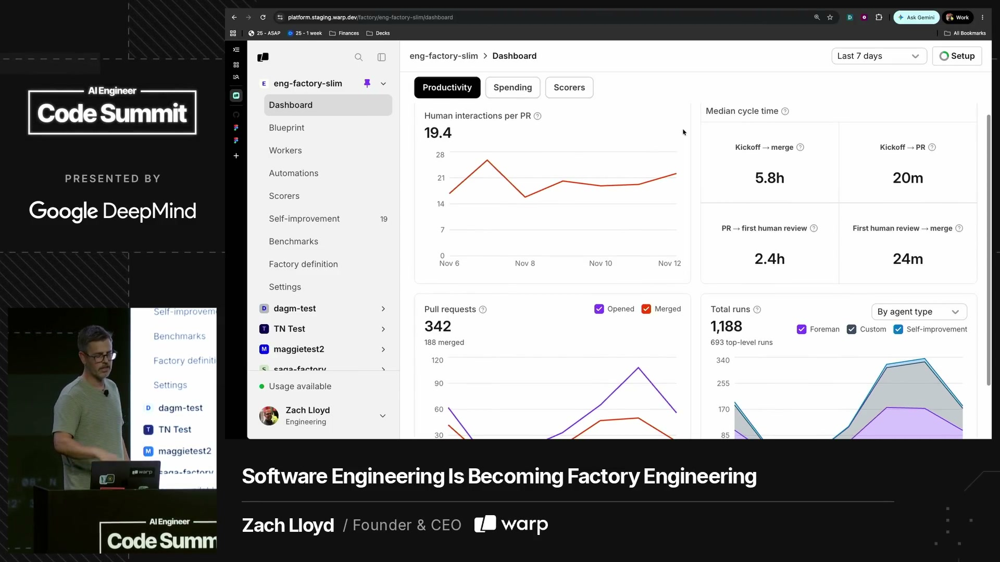

The spending view shows **$10.68 per PR** for Warp-hosted usage and labels the associated total **$3,651.68** (approximate) across **342 PRs**. The chart splits cost into compute, platform, and inference. A separate panel groups spending by source, so the team can inspect which entry points generate spend. [13:06](https://www.youtube.com/watch?v=0LeT996Hz3E&t=786s)

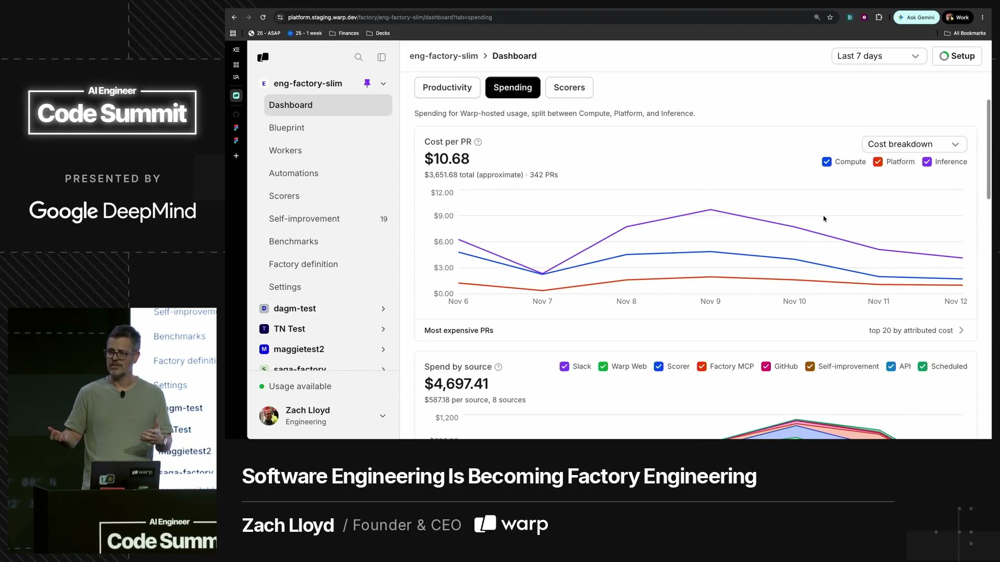

## Demo · An online eval for redundant tests · [13:21](https://www.youtube.com/watch?v=0LeT996Hz3E&t=801s)

An online eval uses another agent to inspect a recorded session and judge one dimension of its output. Lloyd’s example is a worker that adds unnecessary tests. Warp’s **Redundant Tests** scorer examines the final delivered test diff for redundant, low-signal, or trivial tests. It can judge the artifact even if nobody subsequently asks for a deletion. The scorer page shows its 30-day pass-rate trend and an all-time scorer cost of **$43.54**.

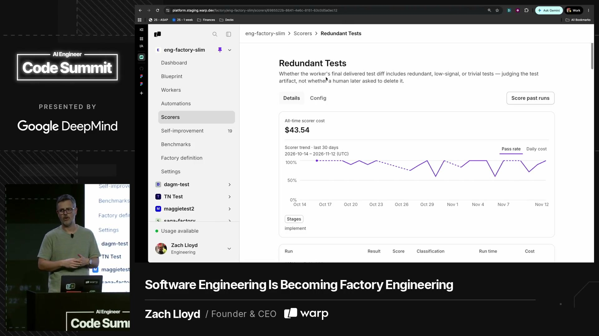

In the seven-day view, **23 passed and 5 failed (82%)**. To investigate what happened, Lloyd opens the individual results. One row scores **0.4**, classified as **Some surplus tests**. Another scores **0.5** and passes with **Insufficient evidence**. A pass count alone conceals that distinction. The individual runs are where the team can look for a common cause.

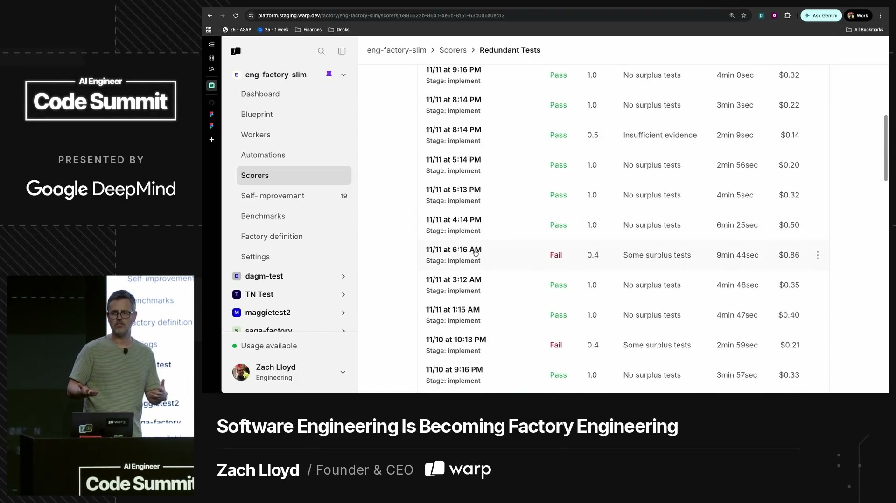

Lloyd also shows how the team locates a run in its workflow. The blueprint displays **9 stages** and **28 transitions**. Five stages sit inside `work`, and the run counts sit on the stages themselves. Here, two runs are in `triage`. [14:30](https://www.youtube.com/watch?v=0LeT996Hz3E&t=870s)

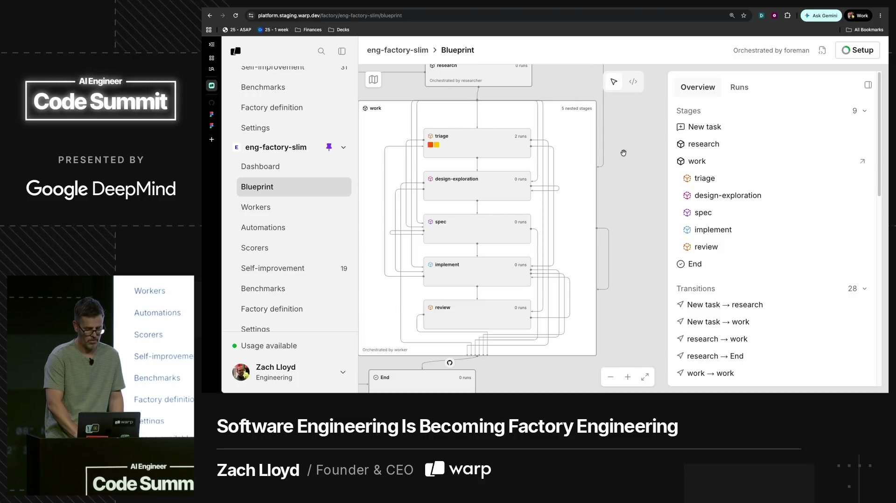

## Demo · A recurring failure becomes a pull request · [14:57](https://www.youtube.com/watch?v=0LeT996Hz3E&t=897s)

A self-improvement agent reads score outputs, groups failures, and proposes a change to the factory definition. The example Lloyd opens is **Check GitHub capabilities before declaring publication blocked**. The suggestion links **12 failed runs**. The diagnosis cites **three tasks** where people had to correct an overly broad claim about access. A GitHub CLI failure had led the agent to declare publication blocked even when Git transport or PR creation over MCP was still available.

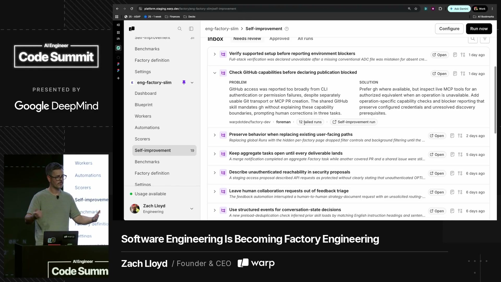

The suggestion became **draft PR #1328**. Its evidence includes a run where Git push worked while PR tools failed separately. The proposed edit to `eng-factory-slim/skills/github/SKILL.md` tells future agents to check the specific operation they need, use an authorized equivalent when available, and report the exact operation that failed. The demo reaches a reviewable change to shared instructions. Its effect on later runs would need another measurement.

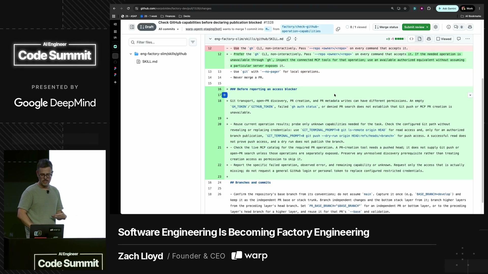

## Demo · Benchmark on the team’s own tasks · [15:51](https://www.youtube.com/watch?v=0LeT996Hz3E&t=951s)

An online eval asks how an actual run went. A benchmark asks how the **same tasks** go when the team changes a model, harness, skill, or factory configuration. Lloyd suggests replaying real work, including experiments as simple as removing a skill. Warp’s catalog includes separate benchmarks for triage, specification, review, and foreman model selection.

On screen, **WarpBench 0.1** contains self-contained implementation tasks distilled from actual Wilson factory runs. The description lists **10 easy, 9 medium, 5 hard, and 5 extra-hard** tasks covering configuration, client UI, server logic, and work spanning multiple parts of the factory. The prompts represent work delegated to an implementation agent. That scope matters when applying the results to other roles.

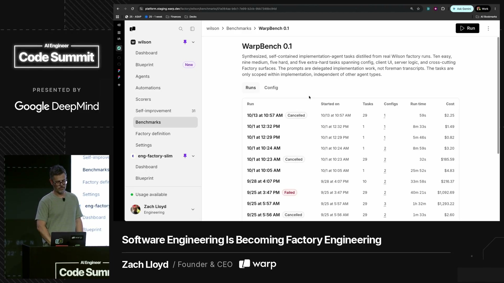

Lloyd opens a run with **29 tasks and 5 configurations**. The live chart plots **Correctness** against **Average cost**. He favors the upper left, where a configuration gets more tasks right at a lower cost. The tooltip for `glm 5.3 flash` shows **92.9%** at **$1.99** average cost. The chart flags incomplete results for `glm 5.3 flash` and `grok 4.6 (high)`. Both have **28/29 tasks scored**. Those figures describe this replay of Warp’s work. [16:44](https://www.youtube.com/watch?v=0LeT996Hz3E&t=1004s)

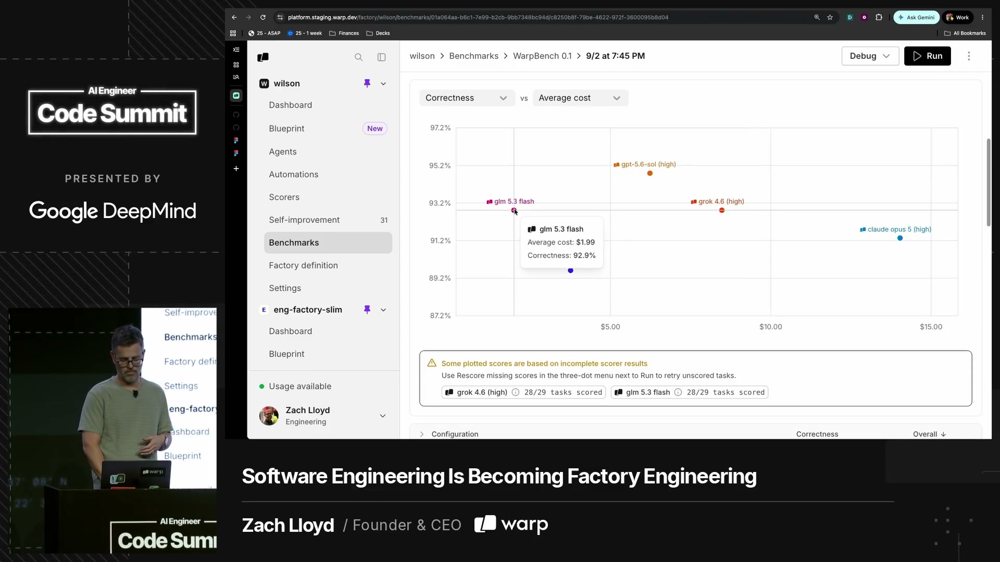

## What Warp changed · [17:13](https://www.youtube.com/watch?v=0LeT996Hz3E&t=1033s)

Warp took a performance baseline and added focused scorers where the team suspected problems. The closing slide shows that they benchmarked subagents, a worker with a foreman, and a solo agent. They also benchmarked models, used the findings to build custom model routers, and fed the results back into the factory code.

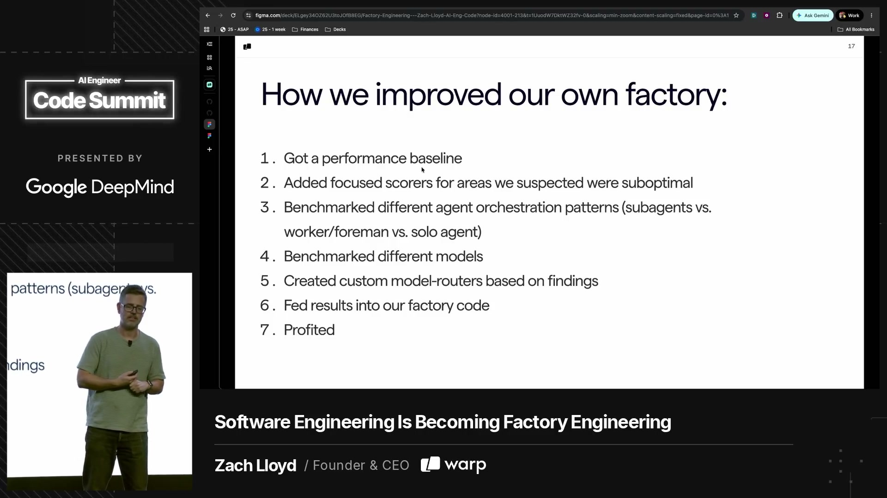

Lloyd reports higher throughput and lower cost from repeating this process. He gives the direction of the improvement without a before-and-after figure. He closes by connecting this work to the engineering skills he learned earlier in his career. Engineers still decide what problem is worth solving, gather evidence about how the system behaves, and change its design when the evidence warrants it. [17:38](https://www.youtube.com/watch?v=0LeT996Hz3E&t=1058s)

Word source · YouTube captions, `en-orig (automatic)` · 4 index sheets viewed · 32 individual frames opened at full size.
